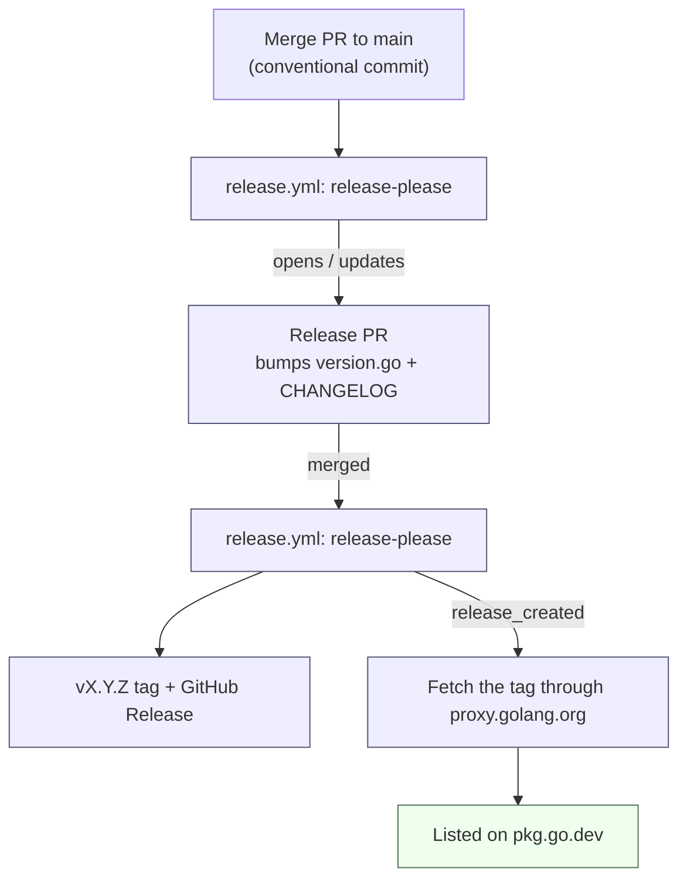

# Releasing

Versioning is automated. Release Please owns the version and changelog. Go modules are published by pushing a git tag, so the tag Release Please creates is the release: nothing is packed or uploaded anywhere.

## Pipeline

- **Tags** are plain `vX.Y.Z` at the repository root, which is what Go expects for a root module.
- **The proxy fetch** after each release caches the new version on proxy.golang.org, so index.golang.org and pkg.go.dev pick it up within minutes instead of waiting for someone to request it.

## Cutting a release

1. Merge changes to `main` using a [conventional commit message](https://www.conventionalcommits.org/).
2. Release Please opens or updates a **release PR** that bumps the version and updates the changelog.
3. Merge the release PR. The tag, GitHub release and proxy fetch run automatically.
4. Confirm the version on [pkg.go.dev](https://pkg.go.dev/github.com/OctopusDeploy/openfeature-provider-go?tab=versions).

## Versioning before v1

The first release is `v0.1.0`. While the major version is 0, a breaking change bumps the minor version instead of moving to `v1.0.0`, so the module path stays the same.

Promotion to `v1.0.0` is a deliberate decision once the provider has been adopted. Make it by merging a commit with a `Release-As: 1.0.0` footer. It needs no module-path change, because Go only adds a `/vN` suffix from v2 onwards.

Retracting a release uses a `retract` directive in `go.mod` rather than deleting the tag, because the proxy keeps every version it has seen.
