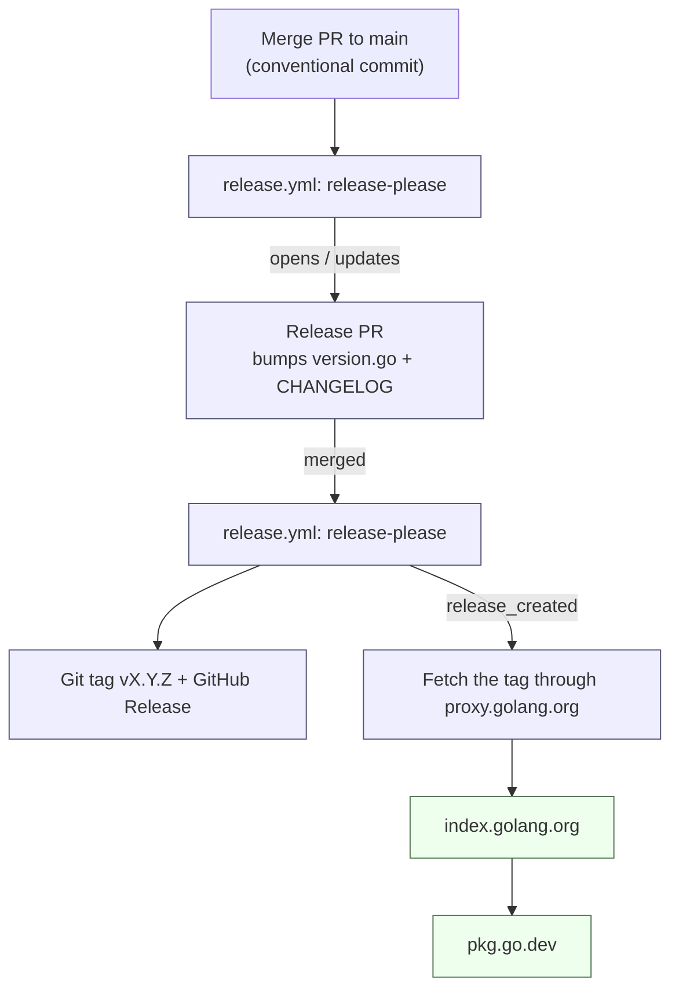

# Releasing

Versioning and publishing are automated. Release Please owns the version and changelog, and the git tag it creates is the release. Go modules are served straight from the repository through the module proxy, so there's nothing to pack and no registry to publish to.

## Pipeline

- **Release builds** run after a Release Please PR is merged. Release Please tags the merge commit `vX.Y.Z` and creates a GitHub release, then a follow-up job fetches the new version through [proxy.golang.org](https://proxy.golang.org) so that [pkg.go.dev](https://pkg.go.dev/github.com/OctopusDeploy/openfeature-provider-go) picks it up within minutes.
- The release workflow can also be run manually from the Actions tab to re-run Release Please without pushing a commit, for example after a failed run. Manual runs only do anything on `main`.

## Versioning

- The first release is `v0.1.0`, set by `initial-version` in `release-please-config.json`. It has no effect once a release exists.
- While the major version is 0, a breaking change bumps the minor version (`bump-minor-pre-major`), so it can't promote the module to `v1` by accident.
- **A pushed tag is permanent.** The module proxy caches every version it has served, so deleting or moving a tag doesn't take it back. Check the version in the release PR before merging. A bad version can only be [retracted](https://go.dev/ref/mod#go-mod-file-retract) in a later release.
- **Promoting to `v1.0.0`** is a deliberate step, taken once the provider has been adopted. It needs no module-path change. Open a PR titled `chore: release 1.0.0` (an empty commit is enough), and when squash merging it, add `Release-As: 1.0.0` to the commit description. The repository squash merges with a blank description by default, so a footer on the branch's commits doesn't survive. Release Please then proposes `1.0.0` in the next release PR.
- **From `v2` onwards** the module path must end in `/vN`. A major bump means editing the `module` line in `go.mod` and the module's own imports in the same release.

## Cutting a release

1. Merge changes to `main` using a [conventional commit message](https://www.conventionalcommits.org/).
2. Release Please opens or updates a **release PR** that bumps the version and updates the changelog.
3. Merge the release PR. The tag, GitHub release and module proxy fetch run automatically.
4. Confirm the version on [pkg.go.dev](https://pkg.go.dev/github.com/OctopusDeploy/openfeature-provider-go?tab=versions).
